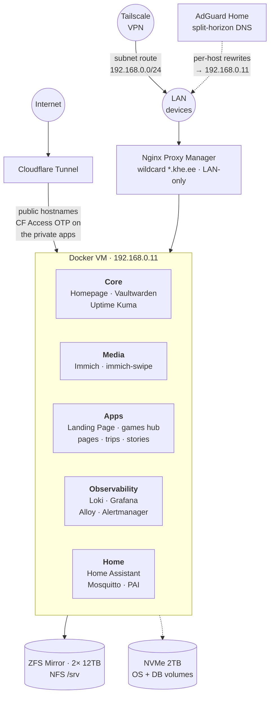

# Architecture

How the homelab fits together: the two paths in, the services and their
domains, the automation that keeps it running and the resilience layers. The
access model is in
[SECURITY.md](SECURITY.md#access-model), the LAN and DNS in
[infrastructure/network/](infrastructure/network/) and the hardware in
[infrastructure/proxmox/](infrastructure/proxmox/).

## Overview

> NPM, AdGuard, and Cloudflare Tunnel also run on the same Docker VM (shown above in the ingress tier, not listed again inside Core).

Two independent paths to the same containers:
- **External** — Cloudflare Tunnel goes directly to each container. CF Access OTP gates the private apps. Subject to Cloudflare's 100MB upload limit.
- **LAN / Tailscale** — AdGuard rewrites the LAN-served hostnames to `192.168.0.11`, so devices hit NPM with the wildcard cert and no upload limit. `draft`, games and pages have no LAN shortcut and always go through Cloudflare; `dash`, `trips` and `stories` are Access-gated only from outside.

Which hostname goes where, and which ones Access gates, is in [infrastructure/cloudflare.md](infrastructure/cloudflare.md).

Proxmox VE (192.168.0.10) is the hypervisor; the Docker VM (192.168.0.11) runs every service. Fast storage (NVMe) holds the VM root + DB volumes; bulk storage (ZFS mirror, NFS-mounted at `/srv`) holds photos and backups.

## Services

| | Service | Domain | What it does |
|---|---------|--------|-------------|
| 🌐 | **Landing Page** | `khe.ee` | Public family landing page; shared trips under `/r/`, the trip atlas demo under `/trips/`, the published bedtime stories under `/stories/` |
| 🏠 | **Homepage** | `dash.khe.ee` | Service dashboard with live widgets (CF Access protected) |
|  | **Immich** | `photos.khe.ee` | Photo library with ML tagging (Google Photos replacement) |
| | **immich-swipe** | `swipe.khe.ee` (LAN + Tailscale) | Swipe-style photo triage frontend for Immich; not on the Cloudflare Tunnel |
|  | **Vaultwarden** | `vault.khe.ee` | Password manager with Passkey support |
|  | **Uptime Kuma** | `status.khe.ee` | Service monitoring and alerts |
| 🎮 | **games hub** | `games.khe.ee` | Launcher, khe-study (`/study/`) and khe-ai-adventure (`/adventure/`), auto-deployed from GitHub |
| 🗺️ | **trips** | `trips.khe.ee` | Private family trip atlas, CF Access protected, own GitHub runner |
| 🌙 | **stories** | `stories.khe.ee` | Unejänku, the family's bedtime stories app, CF Access protected; khe-bunny-tales' runner deploys it, audio in `/srv/data/stories/audio`; `stories-api` under `/api/` takes the children's story requests |
| 📝 | **pages** | `pages.khe.ee` | Quick-publish HTML pages; edited at `draft.khe.ee` (CF Access protected) |
|  | Home Assistant | `home.khe.ee` (LAN + Tailscale) | House automation: HVAC, grid metering and cameras over local protocols. Deliberately not on the tunnel; the house detail is in the private khe-meta repo |
| | Mosquitto | internal only | MQTT broker for Home Assistant and PAI; on `home-internal` only, publishes no host port |
| | PAI | internal only | Bridges the Paradox alarm panel to MQTT; on `home-internal` only |
|  | AdGuard Home | LAN + Tailscale | DNS ad-blocking on the LAN + split-horizon DNS; over Tailscale it answers only the `khe.ee` zone |
|  | Nginx Proxy Manager | LAN only | Reverse proxy + wildcard SSL for LAN traffic |
|  | Cloudflare Tunnel | — | Secure external access (no open ports) |
|  | Grafana + Loki + Alloy + Alertmanager | LAN only | Log aggregation for every container, Telegram alerting via Loki ruler |
| | autoheal | — | Restarts any container whose healthcheck turns unhealthy |

## Automation

Operational work is kept to a minimum by pushing everything into code and cron.

- **GitOps** — every `docker-compose.yml`, Homepage config and AdGuard config
  is version-controlled here. Rebuilding any service is `git pull && docker compose up -d`.
- **Renovate** — watches every pinned image tag except the estate's own and opens PRs for updates (digests + changelogs).
- **GitHub Actions self-hosted runners** — repo-specific runners on the Docker VM deploy
  `khe-sites` (`khe.ee` and the games launcher), `khe-study`, `khe-trips` and
  `khe-bunny-tales` (the stories app) into `/srv/data/...` directories served by nginx, and `khe-home-assistant` into Home
  Assistant's config volume.
- **Estate images**: `khe-ai-adventure` is built in GitHub-hosted CI and published to
  GHCR; this repo pins the digests and the app's CI moves them in an automerged pin PR,
  so its deploy is a merge here, minutes after the push.
- **OS update reminders** — `scripts/os-status.sh` pushes the Proxmox host's and
  the VM's update state to Uptime Kuma daily, which pages Telegram when a reboot is
  due or an update has waited 30 days, and on the host also when a ZFS pool, a
  disk's SMART verdict or the last scrub's age is bad.
- **Certificate renewal** — NPM auto-renews the wildcard cert via Cloudflare DNS API. No manual steps.
- **Backups** — `scripts/backup.sh` dumps every Postgres DB, the Home Assistant
  recorder and the service configs on a schedule; `scripts/offsite-backup.sh` then
  pushes the set to Cloudflare R2 with `restic` (client-side AES-256), which is what
  makes this 3-2-1. See [infrastructure/offsite-backup.md](infrastructure/offsite-backup.md).

## Resilience

Six layers, each catching what the others miss:

1. **Kernel hang: hardware watchdog.** The Docker VM runs the `watchdog` daemon
   pinging `/dev/watchdog` (Proxmox-emulated iTCO, 30s hardware timeout). If the
   kernel wedges (OOM, I/O lock, driver bug), the hypervisor force-resets the
   VM and Proxmox boots it back up. Conservative config: only pings the device,
   no load/memory/network checks (those cause false-positive reboots on blips).
2. **Unhealthy container: autoheal sidecar.** `willfarrell/autoheal` talks to a
   narrow-scope socket proxy and restarts
   any container whose Docker healthcheck reports `unhealthy`. Fills the gap
   left by `restart: unless-stopped`, which only reacts to full crashes. This
   caught a stuck immich-ml worker the day it was deployed.
3. **Runaway service: Compose resource limits.** Every long-running container
   has conservative memory and CPU limits in its `docker-compose.yml`; media
   and database workloads get larger caps than static web services. This
   keeps one bad process from consuming the whole VM.
4. **Service down: Uptime Kuma + Telegram push.** Kuma watches the services
   with HTTP/DNS monitors and takes push heartbeats from the backups and the OS
   update reports; all notify the same Telegram bot (`@khe_homelab_bot`).
   Alert lands on the owner's phone within ~90s. Kuma
   DB is in `backup.sh`, so monitor + notification config survives a VM rebuild.
5. **Whole homelab down: external UptimeRobot.** Pings `khe.ee/healthz`
   every 5 min from outside the home network, pushes to the UptimeRobot iOS
   app. The only layer that can notify when the VM, Proxmox, or the home
   internet itself is unreachable (when layers 1–4 can't reach any network).
6. **Whole homelab down, static copy at the edge.** A Cloudflare Worker in
   front of `khe.ee` and `games.khe.ee` serves an hourly copy of the static
   sites when the homelab answers 5xx or not at all
   ([estate ADR-016](https://github.com/khelias/khe-architecture/blob/main/decisions/016-static-fallback-at-the-edge.md)). Visitors outside the home network still get the
   pages; the APIs and `/healthz` fail as they should, so layer 5 still
   alerts.
