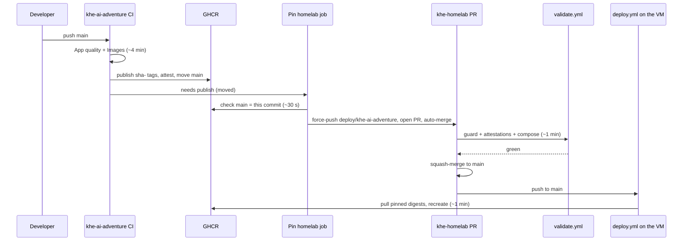

# Operational notes

Per-service quirks and gotchas not covered in [`README.md`](../README.md).
Read on demand when working on the relevant service. Loading this whole
file in every session is wasteful; the entries are independent.

## AdGuard Home

- **Live config is `.gitignored`.** Baseline lives in
  `services/core/adguard/config/AdGuardHome.template.yaml`. Apply changes as delta-
  patches against the live YAML. Wholesale replacement wipes admin bcrypt +
  active sessions.
- **Per-service rewrites only**, no wildcard. Each LAN-served hostname has
  its own rewrite to `192.168.0.11`; the live list is in the live YAML. `games.khe.ee` is intentionally omitted - it resolves via
  Cloudflare for HTTPS.
- **Router DHCP DNS: `192.168.0.11` ONLY**, no secondary. A "fallback" DNS
  triggers happy-eyeballs racing - clients query both in parallel and CF
  always wins, so ad/tracker filtering silently bypasses AdGuard for ~80%+
  of traffic. Better to fail loudly if AdGuard is down.
- **Blocklists**: AdGuard DNS filter + OISD big (~330k rules) + Hagezi Pro
  Plus (~245k, covers EU/EE trackers like Cxense/Piano/Gemius) + Hagezi
  Threat Intelligence medium (paired with built-in Safe Browsing for layered
  defense). Not the full TIF: it swings between 1.0M and 2.2M rules, and the
  daily filter update holds old and new rules at once, so from about 1.75M
  rules the update OOM-killed AdGuard inside its 1G limit every night
  (2026-10-13 to 11-04, about 14 s without DNS each time).
- **Upgrades only go forward.** v1.0 rewrote the live YAML to schema 35,
  which v0.107 refuses to start on, so rolling back the image means
  restoring the copy taken before the upgrade
  (`AdGuardHome.yaml.pre-v1`) with it. From v1.0 a minor release may also
  break things, so read each critical-infrastructure PR's AdGuard notes.
- **Safe Browsing config key is `safebrowsing_enabled`** (one word).
  `safe_browsing_enabled` is a silent no-op.
- **`ratelimit_whitelist` does NOT accept CIDR**, only bare IPs. The
  LAN-friendly knob is a higher `ratelimit` value (currently 100 req/s
  per /24).
- **Memory limit 1G.** 256M was too tight once OISD big + Hagezi loaded; 512M
  also turned out to be too tight (2-4 OOM-kills/day observed early May 2026,
  ~10s DNS outage each = "wifi dropped" symptom on clients).
- **Per-client filtering** (parental + safesearch for kids) is the right
  architecture but requires >=1 MAC/IP per persistent client. AdGuard
  crash-loops on empty `ids: []`. Not provisioned yet; wire when kids'
  device IDs are collected. Apply to LIVE YAML via delta-patch only -
  never commit MAC/IP addresses to the template (public repo).
- **Custom user_rules**: `||connect.facebook.net^` (FB Pixel) and
  `||cxswyjy.com^` (Creality printer Chinese telemetry).
  `crealitycloud.com` left alone so the Creality Cloud app still works.

## Nginx Proxy Manager

- **Wildcard `*.khe.ee` Let's Encrypt cert** via Cloudflare DNS-01 (auto-renew).
- **Proxy hosts**: one per AdGuard rewrite: `khe.ee`, `dash`, `vault`,
  `photos`, `status`, `home`, `swipe`, `trips`.
- **The upload-heavy host** (photos) has unlimited body size + 600s
  timeouts. Applies to LAN clients only; the CF
  tunnel does not route through NPM (see Cloudflare Tunnel section).
- **All hosts**: WebSocket, HTTP/2, HSTS, SSL forced, block exploits.
- **Admin UI**: `http://192.168.0.11:81`. The login lives in NPM's own
  database (`npm_data` volume), set in the UI; no `.env` holds it.
- **CF API token for DNS-01** is stored inside NPM's database
  (`npm_data` volume), not in repo.
- **Not behind NPM**: `games` (CF-only routing).

## Cloudflare Tunnel + Access

- Tunnel routes directly to Docker containers, `photos.khe.ee` included.
  Verified 2026-08-03: a request through the CF edge carries neither NPM's
  `x-served-by` nor its HSTS header, only Immich's own `x-powered-by:
  Express`. **NPM's per-host tuning (unlimited body, 600s timeout) therefore
  applies to LAN traffic only** - split-horizon DNS sends LAN clients to NPM,
  external clients bypass it entirely.
- Access policies (email OTP) protect: `dash.khe.ee`, `trips.khe.ee`,
  `draft.khe.ee`. For `dash` and `trips` only from outside: on the LAN and
  over Tailscale their AdGuard rewrite sends clients to NPM, so Access never
  sees them.
- `khe.ee` is fully public (landing page).
- **Healthcheck must be `cloudflared tunnel ready`, not `cloudflared version`.**
  The old check only proved the binary could execute, so it stayed green through
  the 2026-08-22 outage where every hostname served CF error 1033: the process had
  not crashed, so `restart: unless-stopped` saw nothing, and it never went
  unhealthy, so autoheal saw nothing either. `tunnel ready` queries the `/ready`
  endpoint, which reflects real edge registration, and requires `--metrics` on the
  run command to have something to query. The image is distroless (no shell, curl
  or wget), so the check has to invoke the `cloudflared` binary itself.
  Since the check now reflects edge state, autoheal acts on it: a tunnel that
  loses its edge registration is restarted automatically within roughly two
  minutes. So an unexplained tunnel restart in the logs is autoheal doing its
  job, not a crash.
- **A tunnel outage is invisible to Uptime Kuma.** Kuma runs on this VM and reaches
  services over the LAN through NPM, which tunnel traffic never touches, so internal
  monitors stay green while the public side is entirely down. Detecting it needs an
  external monitor, or the edge probe in the status snapshot (`homelab-status.sh`), which forces the
  Cloudflare address via `curl --resolve` and sends a browser User-Agent to avoid
  WAF custom rule 3.
- **CF error 1033 on every hostname** means the tunnel is not registered with the
  edge at all, not that one service is broken. Check outbound connectivity from the
  VM first: on 2026-08-22 the cause was a router DHCP misconfiguration, so the VM
  had no path out while every container kept running normally.
- See [`infrastructure/cloudflare.md`](../infrastructure/cloudflare.md).

## Edge fallback

Two Cloudflare Workers hold a copy of the static `khe.ee` and `games.khe.ee`
sites and answer only when the homelab does not ([estate ADR-016](https://github.com/khelias/khe-architecture/blob/main/decisions/016-static-fallback-at-the-edge.md); routes and
token in [cloudflare.md](../infrastructure/cloudflare.md#workers-routes)).

- **Is it serving?** A response from the copy carries `X-KHE-Fallback: 1`:
  `curl -sI https://khe.ee/ | grep -i x-khe-fallback`, from outside the home
  network (inside it `khe.ee` goes to NPM). `https://khe.ee/healthz` and
  `/adventure/api/*` never come from the copy, so they fail during an outage.
  In fallback the adventure game shows "AI unavailable": the copy's
  `config.js` has no API secret and the proxy is down anyway.
- **Sync.** `edge-fallback.yml` runs hourly on the homelab runner:
  `scripts/edge-fallback-stage.sh` copies `/srv/data/sites/khe`,
  `/srv/data/trips/share`, `/srv/data/trips/demo`, `/srv/data/games/launcher`,
  `/srv/data/games/study` and the pinned `adventure-web` image's build into
  `.stage/`, and each site is deployed only when its tree or the Worker
  changed (hash in `~/.cache/khe-edge-fallback/` on the runner). A deploy
  reaches the copy within the hour; nothing syncs while the homelab is down.
  A withdrawn share slug stays in the copy until the next sync.
- **Force a sync:** `gh workflow run edge-fallback.yml -R khelias/khe-homelab`.
  To redeploy an unchanged tree, delete the site's hash file on the runner
  first.
- **Turn it off:** delete the two routes in the dashboard (Workers & Pages →
  the Worker → Domains & Routes); the sites behave as before at once. Disable
  `edge-fallback.yml` so the sync stops too.
- **Changing nginx:** a header, redirect or SPA-fallback change in the
  landing or games `nginx.conf` goes into
  `infrastructure/edge-fallback/src/rules.mjs` in the same commit;
  `node --test infrastructure/edge-fallback/test/` (also the workspace
  commit gate) fails on header drift. A new public tree under `khe.ee` or
  `games.khe.ee` reaches the copy only through the staging script's
  allowlist.
- **Installed apps** ([estate ADR-041](https://github.com/khelias/khe-architecture/blob/main/decisions/041-installed-apps-stay-on-their-paths-with-a-worker-each.md)):
  each app's manifest and HTML are served `no-cache` and its `sw.js` `private,
  no-cache`, because Cloudflare rewrites a plain `no-cache` on a `.js` file to
  its four-hour browser cache. A missing `sw.js` is a 404 and never the page,
  and the copy passes `sw.js` through to the origin. The manifest type comes from an exact-match location, since
  `mime.types` has no `webmanifest` entry. The trips bundle holds the private
  atlas, so `/assets/` there is `private`.

## Homepage

- Live widgets where the service has an API. Config in `services/core/homepage/config/`
  (git-tracked bind mount).
- API keys in VM `.env` only, never committed.
- The Uptime Kuma widget reads the Kuma status page with slug `homelab`;
  without it the widget errors. Kuma status pages cannot be private, so
  `status.khe.ee/status/homelab` opens without a login on the home route
  (LAN and Tailscale), while Access covers all of `status.khe.ee` from
  outside: put only monitors whose names are fine to show.
- **Regenerate API keys** from scratch:
  - Proxmox: a privilege-separated token of the read-only `monitor@pve` user
    ([Proxmox API tokens](../infrastructure/proxmox/README.md#api-tokens)),
    never a `root@pam` token
  - Immich: create the key by hand in the Immich UI (there is no helper
    script)

## Games hub (launcher + study + adventure)

Stack: `services/apps/games/` (nginx + adventure-web + adventure-proxy).

- `/` -> launcher (`khe-sites` repo deploys to `/srv/data/games/launcher/`)
- `/study/` -> `khe-study` (`/srv/data/games/study/`, GH Actions runner deploys here)
- `/adventure/` -> `adventure-web` container (`khe-ai-adventure` web image)
- `/adventure/api/` -> `adventure-proxy` container, prefix stripped
- CF tunnel route `games.khe.ee` -> `games:80` (direct, no alias).

**Vite base path** for sub-app deployments:

- `khe-study`: `vite { base: '/study/' }`, BrowserRouter `basename="/study"`
- `khe-ai-adventure`: same pattern with `/adventure/`

**Adventure images** (built in `khe-ai-adventure` CI, [estate ADR-008](https://github.com/khelias/khe-architecture/blob/main/decisions/008-container-images.md)):

- `ghcr.io/khelias/khe-ai-adventure-web` and `-proxy`, public packages,
  pinned here as `:main@sha256:`. After each publish, adventure's CI moves
  both pins in one PR through the `khe-adventure-pins` App, and the PR
  automerges once `validate.yml` passes ([runbook](runbook.md#estate-app-deploy)).
  Renovate does not touch these images.
- The web image writes `/adventure/config.js` at start from `API_SECRET`,
  from the same games `.env` as the proxy. Rotating the key is an `.env`
  change and a recreate, no rebuild.
- The proxy's production usage budgets are the `PROXY_MAX_*` lines in the
  compose; they are in-memory and reset on every recreate.
- The games nginx resolves both upstreams per request (`resolver
  127.0.0.11`), because every deploy recreates both containers.

**Per-repo runners on the VM**:

- `/home/khe/actions-runner` - khe-study
- `/home/khe/actions-runner-adventure` - unregistered and its service
  removed on 2026-11-26 (khe-ai-adventure had no job for it since its images
  moved to CI); the directory stays until the operator deletes it
- `/home/khe/actions-runner-sites` - khe-sites
- `/home/khe/actions-runner-trips` - khe-trips
- `/home/khe/actions-runner-homelab` - khe-homelab
- `/home/khe/actions-runner-home-assistant` - khe-home-assistant
- `/home/khe/actions-runner-bunny-tales` - khe-bunny-tales (copies the
  stories app's builds into `/srv/data/stories/`; estate ADR-031)

`backup.sh` saves the identity of every `actions-runner*` directory that has
a `.runner` file.

A new runner, by the operator since the registration token is a secret: on
the Mac `gh api -X POST repos/khelias/<repo>/actions/runners/registration-token --jq .token`;
on the VM, in a new `/home/khe/actions-runner-<name>`, unpack the current
`actions-runner-linux-x64` release, then `./config.sh --unattended --url
https://github.com/khelias/<repo> --token <token> --name <name>-runner
--labels homelab`, `sudo ./svc.sh install khe` and `sudo ./svc.sh start`,
and add it to the list above.

**nginx mount nesting**: study is bind-mounted **outside** the launcher root
and served via a per-location `root`. Do NOT nest it under
`/usr/share/nginx/html` - nginx then sees launcher placeholders and returns
403 for `/study/`.

**Networks**: `games-internal` (nginx <-> adventure-web, adventure-proxy) + `proxy`
(CF tunnel -> nginx).

**API keys**: `GEMINI_API_KEY` in `services/apps/games/.env` on VM (never
committed). `ANTHROPIC_API_KEY` is unset since 2026-11-17, so the proxy's
Claude mode answers 503; setting it again turns the mode back on.
The Gemini key bills a prepaid AI Studio account that the stories
service's key shares, with auto-reload off and a monthly spend cap per
project (the game's: €1). When the balance runs out, Gemini answers 402 "prepayment credits
are depleted" and the game stops; the proxy logs it, so check
`{container_name="adventure-proxy"}` in Loki first.

### Image pins

How an adventure push becomes a running container (estate ADR-008):

**The pin App guard** in `validate.yml` is inline in the workflow, because
the App cannot change workflow files. It applies when the PR's author or the
event's sender is the App, or when the repository activity API shows any App
activity on the head ref (the App overwriting someone else's branch is a
force push). The App may then change only its own
`ghcr.io/khelias/<repo>-<part>:main@sha256:` digests in its own compose file,
one line for one line, the lines equal once the digest is stripped. A failed
activity lookup fails the guard, and so does a `workflow_dispatch` run on a
branch the App touched, whose green check would otherwise stand in for the
PR run on the same commit.

**What an app's CI does** for every estate image (estate ADR-008; each
app's `ci.yml` and `AGENTS.md` hold the details):

- Images are `ghcr.io/khelias/<repo>-<part>`, tagged `main` (moves) and
  `sha-<full commit>` (never overwritten). Publish stops unless its commit
  is still the tip of `main`, so a re-run of an old commit cannot move
  `main` backwards.
- Two jobs. `images` builds and scans every image on every PR and push, with
  read-only permissions, and is the required check. `publish` runs only on a
  push to `main` after the quality and `images` jobs, and is the only job
  that can write packages, mint an OIDC token or write attestations. It
  rebuilds with no cache (the gha cache can be written by any step holding
  the runner's cache token, the scanner container and npm scripts included),
  pushes with an SBOM and `provenance: mode=max`, attests every new `sha-`
  digest and checks the attestations before it moves `main`.
- The scan is Grype, run as a container pinned by digest, failing on HIGH
  or CRITICAL findings that have a fix. The ignore file is `.grype.yaml`;
  each rule's reason starts with `until YYYY-MM-DD:` and `images` fails once
  the date has passed. The scanner's Renovate rule: no automerge, a minimum
  release age of 7 days.
- Runtime stages carry no package manager; a web image holds only its built
  assets and a non-root web server. A static frontend gets its `config.js`
  written at start from the container's environment.
- Images that depend on each other (the adventure web and proxy share a
  schema-hash allowlist) are built from one commit in one run, every `sha-`
  tag is pushed before any `main` tag moves, and the pin job moves all their
  pins in one commit from the `sha-` tags.
- The pin job pushes the new digests to `deploy/<repo>`, opens the PR and
  turns on auto-merge, and skips unless GHCR's `main` still points at its own
  commit. Its App key sits in a `homelab-pin` environment limited to `main`.
- An app backend runs as a non-root user, has a healthcheck, logs JSON to
  stdout, has a memory limit in Compose, and runs migrations as a one-shot
  Compose service that the app waits on.

**Observed timings**, the reason the pins moved from Renovate to the App:

- Renovate, first real push (2026-09-28, commit `1991e7a`): publish finished
  at 19:19:31Z. A Dependency Dashboard re-run at 19:22:52Z still listed the
  old digests, and no PR followed. Renovate opened the grouped PR
  khe-homelab#221 at 01:35:44Z on 2026-09-29; it automerged at 01:36:26Z and
  deployed. Publish to merge: **6 h 16 min**. The likely cause is Mend's
  datasource cache, whose logs sit behind the operator's Mend login.
- Pin PR through the App, first real push (2026-09-30, commit `11d65c6`):
  push 11:12:01Z; `App quality` done 11:13:03Z, `Images` 11:14:35Z,
  `Publish images` 11:15:39Z; `Pin homelab` 11:15:44-11:16:06Z opened
  khe-homelab#223; validate, guard and attestations green
  11:16:04-11:16:21Z; auto-merge 11:18:16Z; `deploy.yml`
  11:18:19-11:18:43Z. `ops-status.yml` then showed both containers healthy
  on `11d65c6`. Push to live: **6 min 42 s**. About two minutes of it is
  GitHub's auto-merge acting after the check went green.

## Trips

- `services/apps/trips/` stack (nginx alpine, pinned by Renovate, mirrors landing).
- `trips.khe.ee` -> `trips:80` via CF Tunnel from outside, and via an AdGuard
  rewrite and an NPM proxy host on the LAN and over Tailscale, like dash.
- CF Access protected from outside with the shared `Email + Country=EE`
  policy (same as dash, draft). On the LAN every device on the home Wi-Fi
  reads it without a login; that is the household's choice, as for dash.
- Static SPA: bind mount `/srv/data/trips/app:/usr/share/nginx/html:ro`,
  SPA fallback to `/index.html`.
- Source: `khelias/khe-trips` (private).
- Share sites (one trip each, public by link) and the public demo are served
  by landing at `khe.ee/r/<slug>/` and `khe.ee/trips/`, not here; see
  "Landing page".
- GH Actions runner: `/home/khe/actions-runner-trips`,
  systemd unit `actions.runner.khelias-khe-trips.trips-runner.service`.

## Stories

- `services/apps/stories/` stack: Unejänku's family build at
  `stories.khe.ee` ([estate ADR-031](https://github.com/khelias/khe-architecture/blob/main/decisions/031-stories-public-app-private-stories-audio-outside-git.md)), nginx alpine pinned as trips.
- `stories.khe.ee` -> `stories:80` via CF Tunnel from outside, and via an
  AdGuard rewrite and an NPM proxy host on the LAN and over Tailscale, like
  trips. CF Access from outside with its own application and policy for both
  parents, with the same Country=EE rule (infrastructure/cloudflare.md);
  abroad, the stories saved on the phone still play.
- `/srv/data/stories/app` is the build, at `/`; `/srv/data/stories/audio`,
  the audio store by sha256 (`<sha>.m4a`), at `/audio/`. Both read-only.
  The store is filled from the laptop by khe-bunny-tales'
  `scripts/upload_audio.sh`, is outside git and is in the offsite restic run.
- The page, `sw.js`, the manifest and `catalog.json` are `no-cache`;
  `/assets/` and `/audio/` are `private, max-age=31536000, immutable`, named
  by hash. A miss there, `/saved/` (answered only by the service worker) and
  `/cdn-cgi/` are 404, never the page. The headers are in `headers.conf`,
  included in each location, with a CSP that has no inline script.
- Deployed by khe-bunny-tales' `deploy.yml`: it builds on a GitHub-hosted
  runner and its runner here (`/home/khe/actions-runner-bunny-tales`)
  replaces the contents of `/srv/data/stories/app` and
  `/srv/data/stories/public`, which landing serves at `khe.ee/stories/`.
  It fails when an audio sha in the catalog is not in the store.
- `nginx.conf` and `headers.conf` are single-file bind mounts: a change to
  them alone needs a deploy with `force_recreate`, as landing.
- `stories-api` (khe-stories `server/`, its docs/decisions/002) answers
  `/api/`: pairing a child's phone with the family phrase (estate ADR-038),
  the children's story requests, which it dispatches one at a time to
  khe-bunny-tales' `kids-story.yml` (estate ADR-037), and the Web Push that
  says a story is on the shelf. It sits on `stories-internal` with the
  stories nginx only; that network is not `internal`, as the service calls
  GitHub, Gemini and the push services. Pinned by the `khe-stories-pins`
  App like adventure's images. Its SQLite file is in the local volume
  `stories-api-data`, not NFS and not backed up: losing it means pairing the
  phones again. Read-only root, all capabilities dropped.
- The `.env` keys are in `.env.example`, entered by the `read -rs` pattern;
  the children's names and the phrase's hash live only there. The
  stories job's `report` reaches the service with `docker compose exec -T
  stories-api node notify.ts ...` from this stack's directory; the operator
  lists and revokes phones the same way (`--devices`, `--unpair <id>`). The
  service reads `/srv/data/stories/app/catalog.json`, mounted read-only, to
  see when a committed story is deployed.
- nginx takes the client address from `X-Forwarded-For`, trusting only the
  `proxy` network (`172.18.0.0/16`, where cloudflared and NPM sit), so the
  `/api/` rate limit keys on the visitor through Cloudflare. Through NPM a
  LAN client can name its own address (NPM trusts `X-Real-IP` from private
  ranges), so the service also caps pairing at twenty tries an hour in all. `/api/` allows 3 MB bodies (a recorded idea is at most
  2 MB, sent as base64) and the microphone is allowed for the page itself.
  Uptime Kuma watches `http://stories/api/healthz` over the `proxy` network
  ("Unejänku request service", so a down nginx or service both show).

## Immich

- **`immich-server` needs 6G RAM.** Since v3 the job workers (thumbnails,
  ffmpeg transcode) run inside `immich-server`, not in the ML container.
  With a 2G limit the cgroup OOM-killed ffmpeg + the node process during
  video ingest (observed 2026-08-03); `restart: unless-stopped` brought it
  back ~90s later and every in-flight upload returned 502 via NPM.
  Note `docker inspect .State.OOMKilled` reads `false` in this case -
  `dmesg -T | grep "killed process"` is the authoritative signal.
- **`immich.config.json` edits need `docker compose up -d --force-recreate`.**
  It is a single-file bind mount, Docker binds such a mount by inode, and
  `git pull` / `git checkout` replace the file via rename. A running
  container keeps serving the old inode, so a plain `up -d` reports
  "Running" while the container still holds the previous config. Hit
  2026-08-05: the compose memory limits had applied but preset,
  targetResolution and the CLIP model had not. Verify inside the container
  (`docker exec immich-server grep preset /immich.config.json`), never
  against the file on the host.
- **Video playback serves the transcode, never the original.**
  `/api/assets/:id/video/playback` returns the `encoded-video/` file
  whenever one exists, so every client (phone, TV, browser) watches the
  re-encode. Photos differ: the app fetches the original when you zoom in.
  This is why the transcode profile is a quality decision, not just a
  storage one.
- Transcode policy is `required` + `targetResolution: original` since
  2026-08-05: only files in an unaccepted codec get re-encoded, and those
  keep their resolution. `optimal` / `720` and later `optimal` / `1080`
  both meant every 4K clip was watched as a downscale. `preset: medium`,
  `crf: 23` and `tonemap: hable` only apply to the files that still do get
  transcoded.
- **`acceptedContainers` must list `mp4` explicitly.** Immich's default list
  (`mov`, `ogg`, `webm`) does not cover it, and an unaccepted container
  forces a re-encode regardless of codec - so under `required` every phone
  `.mp4` was still being transcoded (observed 2026-08-05: 9 h264 mp4
  transcodes in 3 minutes immediately after the policy switch). mp4 is the
  container Immich itself writes output into, so accepting it costs nothing.
- **`required` leaves existing transcodes in place.** They keep being
  served until Video Conversion is re-run from the Job Status page, which
  re-evaluates each asset and drops the files the policy no longer wants.
  Originals under `upload/library/` are untouched throughout.
- Browser HEVC support is the risk `required` carries: `hevc` is in
  `acceptedVideoCodecs`, so iPhone 4K clips are now served as-is. The
  mobile apps and Safari handle that, Chrome and Firefox may not. If web
  playback breaks, drop `hevc` from the accepted list - it will then be
  re-encoded to h264 at original resolution.
- `image.fullsize` and `image.extractEmbedded` are on. Without them the
  largest viewable render of a HEIC or RAW original is the 1440px preview,
  because browsers cannot decode the original. Cost is one extra JPEG per
  non-web-native asset.
- **Everything absent from `immich.config.json` runs on its default and
  cannot be changed in the UI.** With `IMMICH_CONFIG_FILE` set, the whole
  admin settings page is read-only. Secrets (SMTP password, OAuth client
  secret) therefore have nowhere to live yet - the file is committed to a
  public repo.
- **Immich's own database backup is off** (`backup.database.enabled: false`;
  without the key Immich's default runs it at 02:00, inside the upload tree
  that is not backed up). The one dump is `scripts/backup.sh`'s `pg_dump`,
  shipped offsite and restored by `restore-verify`, so Immich's own restore
  screen lists nothing: restore by
  [offsite-backup.md](../infrastructure/offsite-backup.md)'s `pg_restore`.
- **Uploads over 100MB fail from outside the LAN** with 413, not 502:
  Cloudflare's free plan caps request body at 100MB and the Immich app
  does not chunk. Measured 2026-08-03: a 120MB POST got 413 from the CF
  edge after ~1.7MB, the same POST via NPM on the LAN reached Immich.
  Routing the tunnel through NPM would not help - the cap is at the CF
  edge, before the origin. Large videos have to go via LAN or Tailscale.

## Immich Swipe

- Companion container (`immich-swipe`) in `services/media/immich/docker-compose.yml`,
  served at `swipe.khe.ee` over LAN and Tailscale only (AdGuard rewrite + NPM
  proxy host to `http://immich-swipe:80`, not on Cloudflare Tunnel).
- Joins `proxy` only (never `immich-internal`) and proxies `/api/` to
  `IMMICH_URL=http://immich-server:2283` so Immich needs no CORS changes and
  the container holds no secrets.
- **Scoped API key:** create a dedicated Immich API key with `user.read`,
  `asset.read`, `asset.view`, `asset.download`, `album.read`, `albumAsset.create`
  (optionally `asset.update`), **omitting `asset.delete`** so an accidental
  left-swipe fails with 403 instead of trashing photos. Login requires both
  Server URL (`https://photos.khe.ee`) and the API key.
- **Workflow (v1.0):** there is no date-range filter, so stage a period into an
  Immich source album first and select `In album` in Settings. Adding a frame
  to the selection album uses `0-9` hotkeys on desktop or AlbumPicker on a
  phone (swiping right only marks kept in `localStorage`; Undo does not remove
  an already-added album item).

## Immich machine-learning

- OpenVINO image (CPU inference, no GPU model needed at this size).
- Resource limits: 6G RAM, 4 CPUs.
- `start_period: 180s` (model load on first start).
- **Smart Search runs `nllb-clip-base-siglip__v1`, not the default
  `ViT-B-32__openai`.** Reason: Estonian queries. Immich has no Estonian
  benchmark, but Finnish is the closest proxy in its own table and there
  the `nllb` family scores ~79% recall against ~40% for the SigLIP2 models
  and far less for the old default. `nllb` models translate the query using
  the **user's UI language**, so each account must have Estonian selected
  in Immich for this to work (`et` maps to `est_Latn` in Immich's
  FLORES-200 table).
- Switching the CLIP model invalidates every existing embedding. After a
  model change, run Smart Search -> "All" from the Job Status page (jobs
  stay usable even though settings are read-only). Expect hours on CPU for
  a large library; the model is worth nothing until that finishes.
- Model TTL is the default 300s, so the first search after an idle period
  reloads a ~4.7G model and takes 10-20s. Levers if that becomes annoying:
  `MACHINE_LEARNING_MODEL_TTL=0` (keeps it resident, permanently spends the
  RAM) or `MACHINE_LEARNING_OPENVINO_PRECISION=FP16` (halves memory, small
  accuracy risk).
- `nllb-clip-large-siglip__mrl` is the upgrade path (~+5pp recall) but is
  5x slower per query on CPU. Not worth it without a discrete GPU.

## Landing page

- Static HTML at `khe.ee` (public), served by nginx alpine (pinned by Renovate).
- `nginx.conf` is a single-file bind mount, so a change to it alone needs a
  deploy of `services/apps/landing` with `force_recreate` (the same inode
  trap as `immich.config.json`); the push deploy's plain `up -d` leaves the
  old config running.
- Security headers (HSTS, nosniff, referrer, permissions, a CSP with no
  third-party hosts but Cloudflare Web Analytics) are set at server level and
  repeated in the static-asset location, since a location with its own
  `add_header` inherits none. HSTS has no `includeSubDomains`:
  the apex policy must not pin LAN-only names. `/r/` keeps its own set.
  `absolute_redirect off`, so `/privacy` -> `/privacy/` stays on https.
- An address with no page answers 404 with khe-sites' `404.html`, on
  games.khe.ee too. The bare `/study` and `/adventure` there answer 301 to the
  app.
- `/lab` and `/lab/`, the Lab Atlas retired in 2026-10, answer 301 to
  `/architecture/` with the query string kept (`?lang=et` survives).
- `/house3d` and everything under `/house3d/`, the Home Assistant demo's old
  path, answer 301 to the same path under `/ha/`, where khe-sites builds it
  since 2026-10, query string kept.
- khe-sites builds the landing, privacy and architecture pages once per
  language, Estonian at the path and English under `/en/` ([khe-sites
  ADR-001](https://github.com/khelias/khe-sites/blob/main/docs/decisions/001-khe-ee-pages-are-one-static-page-per-language.md)).
  The `$lang_page` map answers a `?lang` that differs from the page's
  language with 301 to the other page, query string kept (`/?lang=en` ->
  `/en/?lang=en`), and leaves a matching one alone so nothing loops.
- `/architecture/decisions/` is the decisions page with the register, and
  `/architecture/decisions/<NNN>/` are the ADR pages, all built by
  khe-sites.
- `/r/<slug>/` serves khe-trips share sites from `/srv/data/trips/share`,
  written by the khe-trips runner and mounted outside the html root
  (`/srv/share/r`). An unknown slug, `/r` and `/r/` answer a bare 404.
  Everything under `/r/` is `Cache-Control: private` (assets
  a week in the browser only), so Cloudflare never holds a copy and an
  un-shared trip is gone at once. `/srv/data/trips/share` must exist, owned by
  the runner user, before landing starts, or Docker creates it root-owned and
  the khe-trips deploy can no longer write it.
- `/trips/` serves the public khe-trips demo (a khe-trips decision)
  from `/srv/data/trips/demo`, mounted at `/srv/demo/trips`. It is a
  single-page app: a trip URL falls back to `/trips/index.html`, a missing
  file under `/trips/assets/` is a 404, and `/trips` answers 301 to `/trips/`
  with the query string kept. Headers and caching as on `/r/` (private, never
  at the edge, `X-Robots-Tag` noindex) plus HSTS, and no `robots.txt`
  disallow, so a crawler can read the noindex. The khe-trips deploy creates
  `/srv/data/trips/demo` first, so it must deploy before landing gets the
  mount; the same root-owned trap applies.
- `/stories/` serves Unejänku's public build ([estate ADR-031](https://github.com/khelias/khe-architecture/blob/main/decisions/031-stories-public-app-private-stories-audio-outside-git.md)) from
  `/srv/data/stories/public`, mounted at `/srv/demo/stories`, which shadows
  khe-sites' old `stories/`. It routes by hash, so a missing file is a 404,
  and `/stories` answers 301 to `/stories/` with the query kept. The khe
  headers with `media-src 'self'` and `private, no-cache`; `/stories/assets/`
  a week as on `/r/`, `/stories/audio/` (hard links into the audio store, the
  published stories only) a year, a miss uncached. The khe-bunny-tales deploy
  creates the directory first; the same root-owned trap applies.
- `/healthz` answers `ok` with `no-store`; UptimeRobot and
  `homelab-status.sh`'s edge probe watch it. The edge fallback passes it
  through, so it fails when the homelab is down even while the copy serves
  the pages.
- Homepage dashboard moved to `dash.khe.ee` (CF Access protected).
- `HOMEPAGE_DOMAIN=dash.khe.ee` in homepage `.env`; compose builds
  `HOMEPAGE_ALLOWED_HOSTS` from it plus `homepage:3000`, the Uptime Kuma
  monitor URL. Homepage v2 answers 400 to any other Host, the IP included.

## Pages (dufs editor + nginx)

Quick-publish surface: paste an AI-generated HTML page from any device, get a
public shareable link. Two containers in `services/apps/pages/` sharing
`/srv/data/pages/app` (writer/reader split: the private container writes,
the public one mounts the same directory read-only).

- `draft` (dufs, runs as UID 1000, internal port 8080) is the **private**
  editor. `draft.khe.ee` -> `draft:8080` via CF Tunnel, CF Access protected
  (shared `Email + Country=EE` policy). Flags: `--allow-upload
  --allow-delete --allow-search`; `--allow-delete` is also what lets a `PUT`
  overwrite an existing file. It mounts only the page tree at `/data`; no
  database, no settings outside compose. Root filesystem read-only, all
  capabilities dropped, `no-new-privileges`.
- **CF Access is the only auth layer.** dufs runs without `--auth`, so the
  `draft.khe.ee` Access application must never be removed. `draft` sits only
  on the internal `draft-tunnel` network, shared with `cloudflare-tunnel`
  alone, so nothing on `proxy` can reach it. The tunnel stack owns that
  network because it deploys before `apps/pages`.
- **No healthcheck.** The image is `FROM scratch` (no shell, no wget), and
  Uptime Kuma cannot reach `draft-tunnel`. Liveness is
  `restart: unless-stopped`; Homepage shows the container state.
- **Edit with the pencil icon, view on `pages.khe.ee`.** Clicking a file's
  name in the list opens the raw page on `draft.khe.ee`, where its JS could
  write and delete pages. New files are created `0644`; an edited file keeps
  its mode.
- **A failed save is silent:** the editor reloads whatever the status, so
  check the page on `pages.khe.ee` after saving.
- `pages` (nginx `1.31-alpine`) is the **public** reader. `pages.khe.ee` ->
  `pages:80` via CF Tunnel (public, no Access, no AdGuard rewrite). Mounts the
  same dir `:ro` and a `conf.d` server block, like landing. Workers run as the
  stock `nginx` user, so every page and directory must be world-readable
  (`o+r`, `o+x` on directories); a `0640` file answers 403.
- **Extension-less files render:** `default_type text/html` means a page saved
  as just `unify` (no `.html`) still serves as HTML instead of downloading.
  `.html` names work too (mapped via mime.types).
- **First deploy is permission-sensitive.** Create and chown the tree BEFORE
  the first `docker compose up`, or Docker auto-creates it root-owned and the
  non-root dufs cannot write (same trap as Loki):
  `sudo mkdir -p /srv/data/pages/app && sudo chown 1000:1000 /srv/data/pages/app`
- **Clean URLs:** nginx `try_files $uri $uri.html $uri/ =404` — a flat
  `leht1.html` is shared as `pages.khe.ee/leht1`. The public root `/` answers
  403 until an `index.html` exists; intentional (no directory listing).
- **noindex:** `X-Robots-Tag: noindex` header (authoritative) plus an
  always-200 `/robots.txt` Disallow. The `pages` healthcheck targets
  `/robots.txt`, so it stays healthy even with zero published pages.
- **No auto-expiry:** pages stay public until deleted in the dufs UI.
  `/srv/data/pages` is the one app tree not reproducible from git, so it is in
  `backup.sh` BIND_MOUNTS.
- Headers match the `games`/`adventure` house set minus the strict app CSP
  (it would break user-authored inline JS); only `frame-ancestors 'none'`
  plus the origin-wide HSTS/nosniff/referrer/permissions headers are kept.

## Observability (Loki + Grafana + Alloy + Alertmanager)

- **Stack layout.** Four sub-stacks under `services/observability/`,
  each with its own `docker-compose.yml`: `loki/`, `grafana/`,
  `alloy/` (with a sibling `alloy-socket-proxy`), `alertmanager/`.
  Deploy order is `DEPLOY_ORDER` in `scripts/deploy-order.sh`, which
  `deploy.sh` and `deploy-stacks.sh` both source. loki owns the
  `observability` network, so it comes before every stack that joins it as
  external: `core/uptime-kuma`, then alertmanager, grafana, alloy.
- **Why Alloy, not OTel Collector contrib.** Grafana Alloy is an
  OpenTelemetry Collector distribution — 100% OTLP compatible — with
  native Docker discovery (`discovery.docker`) and a native Docker
  log source (`loki.source.docker`) that the upstream OTel
  Collector lacks. Promtail reached end-of-life on 2026-03-02, so
  it was never a candidate. The initial implementation tried
  upstream OTel Collector + filelog and ended up needing a hand-
  maintained container_id → container_name map; switching to Alloy
  removes that whole layer.
- **First deploy.** Copy
  `services/observability/grafana/.env.example` → `.env` and pick a
  Grafana admin password. Copy
  `services/observability/alertmanager/config/alertmanager.yml.example`
  → `alertmanager.yml`, paste the Telegram bot token + chat ID
  (grab both from Uptime Kuma's web UI → Settings → Notifications;
  the same bot is reused). The live `alertmanager.yml` is
  `.gitignored`.
- **Loki storage.** Chunks + index live on the ZFS mirror at
  `/srv/data/loki`, not NVMe — log retention is 30 days and this
  is bulk data, not hot. First run will need the directory created:
  `sudo mkdir -p /srv/data/loki && sudo chown 10001:10001 /srv/data/loki`
  (Loki runs as UID 10001). Without ownership, Loki errors out on
  its tsdb index init.
- **Log shipping.** Alloy talks to Docker through the hardened
  `alloy-socket-proxy` (tecnativa/docker-socket-proxy with only
  `CONTAINERS`, `NETWORKS` and `IMAGES` read access, no write surface).
  `loki.source.docker` reads each
  container's log stream via `GET /containers/{id}/logs` and ships
  to Loki via the native push API. `container_name`, `stream`, and
  `cluster` are first-class stream labels — query with
  `{container_name="adventure-proxy"}`. `loki.source.file` also tails
  `/var/lib/khe-status/status.log` (bind-mounted read-only), the
  `homelab-status.sh` snapshot, as `{job="homelab-status"}` without a
  `cluster` label, so its FAIL lines stay out of the alert rules and
  dashboards.
- **Loki ruler.** Alert rules live in
  `services/observability/loki/config/rules/fake/` — the `fake`
  subdir is Loki's default tenant ID when `auth_enabled: false`.
  Bind-mounted read-only; Loki polls every minute, fires via
  Alertmanager v2 protocol.
- **Log-content rules must exclude `container_name="loki"`.** Loki
  logs every executed query at info level *including the LogQL
  query string itself*. A rule like `... |~ "panic|fatal" ...`
  matches its own echo as soon as Alloy ships Loki's logs back in,
  fires forever, and every ad-hoc Explore query against the rule's
  metric perpetuates the loop. Always add
  `container_name!="loki"` to the stream selector. Loki's own
  health is covered by the Uptime Kuma `/ready` probe instead.
- **`reject_old_samples_max_age` matches `retention_period`** (both
  720h). Alloy's `loki.source.docker` tails each container from the
  start of its log file; containers running >7d would otherwise hit
  HTTP 400 "timestamp too old" on every batch and silently drop
  all backlog. Anything inside the retention window is acceptable
  to ingest.
- **Grafana datasources.** Loki + Alertmanager, both provisioned
  from `config/provisioning/datasources/` over the shared
  observability network. Alertmanager wires Grafana's
  `Alerting > Alert groups` page to the same Alertmanager the Loki
  ruler fires into, so alert review happens in Grafana rather than
  Alertmanager's bare UI.
- **Grafana dashboards.** Two, both read-only via
  `config/provisioning/dashboards/files/`:
  - `Homelab — Overview` — single-screen state: active alerts,
    log volume per container, top-5 ERROR/WARN/FAIL rate, top-10
    Loki ingestion rate stacked.
  - `Homelab — Container logs` — Explore-style log stream with a
    `container_name` dropdown sourced from
    `label_values({cluster="homelab"}, container_name)`. Auto-
    populates from whatever Alloy is currently shipping, no manual
    ID-to-name map.
- **Grafana ingress.** LAN-only via host port `3030`; Homepage and `mcp-grafana.sh` use it. There is
  no `grafana.khe.ee`: it would need an AdGuard rewrite and an NPM
  proxy host first. **Do not** expose via Cloudflare
  Tunnel without CF Access OTP — log search is the door to every
  container's history. CF integration is a deliberate follow-up
  step.
- **Telegram channel.** Reuses the existing Uptime Kuma bot for
  simplicity. If alert volume gets noisy, split into a second bot
  + chat to keep uptime pings and log alerts on different channels.

## Home Assistant

Runs as HA **Container**, not HAOS, so there is no Supervisor and no add-ons.
Add-on equivalents run as ordinary containers in the same group: today that
is Mosquitto (with PAI as an MQTT client). Zigbee2MQTT is planned, ESPHome is
not set up. See
khe-meta's `house/home-assistant-plan.md` for the phased rollout.

**Trusted proxies live in the UI, not in YAML.** Since HA 2026.8 the `http:`
block is imported once and then ignored, and on this install the import did
not take: NPM requests answered `400: Bad Request` with "your HTTP integration
is not set-up for reverse proxies" in the log while the YAML block was
present. Set Settings -> System -> Network -> HTTP server: Trust
X-Forwarded-For on, Trusted proxies `172.18.0.0/16` (the `proxy` network; check
with `docker network inspect proxy`). Stored in `.storage`, so it survives in
backups but not in the repo.

**NPM needs WebSocket support enabled** on the `home.khe.ee` proxy host. Without
it the frontend loads and then hangs on a blank page, which looks like a HA
fault and is not one.

**Port 8123 is published** for the NVR's event push and the HA scripts.
Docker-published ports bypass UFW, so its `ALLOWED_PORTS` entry in
`harden-docker-vm.sh` only keeps the list true.

**The live config is the `homeassistant_ha_config` volume** on the VM's local
disk, not `/srv/data`: the recorder is a live SQLite database in WAL mode, and
`/srv/data` is a soft NFS mount of the HDD pool. khe-home-assistant's deploy
replaces `configuration.yaml`, `packages/`, `tuya_local_devices/` and
`www/house3d/` in it, after `check_config` passes in a throwaway container of
the running image; it never restarts HA. `.storage` (users, long-lived tokens,
integration credentials), `custom_components/` (HACS and its integrations,
reinstalled by hand) and the recorder are live state that only `backup.sh`
covers.

**Not on the Cloudflare Tunnel, deliberately.** CF Access breaks the HA
companion app login and webhooks, and this host will eventually control the
ventilation and heat pump. Remote access is Tailscale.

**Backup.** `backup.sh` copies the recorder DB via Python's `sqlite3` backup
API in a throwaway container of the running HA image, streamed through gzip
(`homeassistant-recorder.db.gz`). Not through `docker exec`: the page cache of
copying the whole DB is charged to the cgroup the copy runs in, and inside HA's
memory limit that OOM-killed HA at 02:00. The SQLite copy stays in the
throwaway's `/tmp`, off the soft NFS `/srv/backups`. It also tars the config
volume with the live DB, its journals and the log excluded
(`homeassistant-config.tar.gz`). Restore: with HA stopped, untar into the
volume through a throwaway alpine container
(`docker run --rm -v homeassistant_ha_config:/config -v <backup dir>:/backup:ro alpine:3 tar xzf /backup/homeassistant-config.tar.gz -C /config`),
drop the gunzipped DB in as `home-assistant_v2.db` the same way, start the
container.

**Everything about the configuration** (template reloads and the price
refresh, the Nord Pool day, restarts after a deploy, each integration's
quirks, the dashboard and the 3D house view) is in khe-home-assistant's
[operational notes](https://github.com/khelias/khe-home-assistant/blob/main/docs/operational-notes.md).
The HVAC integrations name the units and their LAN addresses, so they live in
the private `khe-meta` repo under `house/house-hvac.md`.

## Healthchecks

- **games**: uses `127.0.0.1` (NOT `localhost`). Busybox wget DNS issue in
  alpine - localhost doesn't resolve.
- **cloudflare-tunnel**: uses `cloudflared tunnel ready` (distroless image,
  no curl/wget available; see the Cloudflare Tunnel section).
- **pai**: no healthcheck. `pai-service` is the container's PID 1, so a
  dead PAI exits the container and `restart: unless-stopped` brings it back;
  a process check could only fail when the image drops its tool, which the
  `pgrep` one did in 3.8.1 and then read unhealthy for good. A dropped panel
  or broker connection PAI retries itself; the signal for that is the alarm
  entities going unavailable in Home Assistant.
- **alloy**, **loki** (>= 3.7): no container-internal healthcheck.
  `grafana/alloy` ships without wget/curl; `grafana/loki` 3.7+ is
  fully distroless (no shell either). Adding a thin Dockerfile
  layer just for a probe breaks the "pinned upstream image"
  convention. Liveness is covered externally by Uptime Kuma
  monitors against `http://alloy:12345/-/ready` and
  `http://loki:3100/ready` on the observability network — that's
  also why `services/core/uptime-kuma` joins `observability` in
  addition to `proxy`.

## autoheal

- **Its proxy is `lscr.io/linuxserver/socket-proxy`, not Tecnativa's.**
  `tecnativa/docker-socket-proxy` v0.5.0 runs `deny unless METH_GET ||
  POST` before its `ALLOW_RESTARTS` rule, so with `POST=0` every restart
  answered 403 and autoheal logged "Restarting container ... failed" every
  10 s; found 2026-11-23, likely so since the v0.5.0 bump of 2026-08-22.
  `POST=1` is not the fix: with `CONTAINERS=1` it opens container create
  and exec, which is root on the VM. linuxserver's template reads the
  restart rule first; upstream Tecnativa #194 would do the same.
- **`ALLOW_RESTARTS` opens restart, stop and kill**, in both images.
  autoheal itself calls only `GET /containers/json` and `POST
  /containers/{id}/restart`.
- **It watches every container with a healthcheck** (`AUTOHEAL_CONTAINER_LABEL:
  all`), compose or not; `autoheal=False` as a label opts one out. A failed
  restart pages through the Loki rule `AutohealRestartFailed`. A check
  that can never pass means a restart every 10 s, so a container whose
  healthcheck the image breaks (PAI's `pgrep` in 3.8.1) needs the check
  fixed or removed, not left unhealthy.
- How to check it: [runbook](runbook.md#checking-autoheal).

## Hardware passthrough

- Intel iGPU bound to `vfio-pci` on Proxmox host (`i915` blacklisted),
  passed through to Docker VM 100.
- VM runs `linux-image-amd64` kernel (cloud kernel lacks i915). The cloud
  kernels are purged and `GRUB_DEFAULT=0`, so the newest installed kernel
  boots; a version pinned in `/etc/default/grub` never takes kernel updates.
- VM apt sources include `non-free-firmware` for Intel firmware packages.
- `/dev/dri` mounted into the `immich-server` and `immich-machine-learning`
  containers.

## VM watchdog

- `watchdog` daemon pings `/dev/watchdog` (iTCO_wdt, Proxmox-emulated
  Intel TCO, 30s timeout).
- If daemon wedges (kernel hang, OOM, I/O lock), hardware force-resets
  the VM within 30s. Proxmox boots it back up.
- **Conservative config**: only pings the device, NO load/memory/network
  checks (those cause false-positive reboots on blips). See
  `/etc/watchdog.conf` on the VM.

## Vaultwarden

- **Backup:** `backup.sh` copies the DB with Vaultwarden's own `docker exec
  vaultwarden /vaultwarden backup` (`VACUUM INTO`, a consistent copy of the
  live SQLite) to `vaultwarden-db.sqlite3.gz`, then tars `/srv/data/vaultwarden`
  as before, live DB included, as `vaultwarden-data.tar.gz`. The subcommand
  writes `data/db_<ts>.sqlite3` next to the live DB; the script removes only
  the copies its own run made, never the admin panel's "Backup database"
  files. Backups from before 2026-11-26 have only the tarred DB.
- **Restore:** `/srv/data/vaultwarden` is not writable by `khe`, so through a
  throwaway alpine container, as the Home Assistant restore: stop the
  container, untar `vaultwarden-data.tar.gz` into `/srv/data/vaultwarden`,
  gunzip `vaultwarden-db.sqlite3.gz` over it as `db.sqlite3`, remove
  `db.sqlite3-wal` and `db.sqlite3-shm`, start the container.

## Restore verify (GH Action)

- `.github/workflows/restore-verify.yml` runs `scripts/restore-verify.sh`
  Sundays 04:00 UTC on the self-hosted homelab runner. Pulls the latest
  restic snapshot from R2, restores the newest dated `immich-postgres.dump`
  into a throwaway Postgres container, and asserts ≥20 public tables before
  tearing down. Then it restores the newest dated backup's Vaultwarden DB
  copy and data tar and checks, in a throwaway `alpine:3` with `sqlite`
  added (the runner host is not known to have `sqlite3`): integrity `ok`, at
  least one user and one item, `rsa_key.pem` in the tar. It prints pass or
  fail only: the Actions logs are public, and the vault's counts do not
  belong there.
  Heartbeat pings Kuma at the end.
- **Why immich-postgres:** it is the one Postgres data service left. Only
  the newest dated copy is restored, because every copy carries the
  embeddings and the job has a 20-minute timeout.
- **Image:** the throwaway container runs the image of the running
  `immich-postgres` container (`docker inspect`), because the dump needs
  the vchord extension. The job fails unless it is a
  `ghcr.io/immich-app/postgres` image.
- **Not covered:** snapshot age and the other volume tarballs (audit
  finding 10 in khe-meta).
- **Manual trigger:** Actions tab → Restore Verify → Run workflow.
  Useful right after touching backup.sh, the Immich Postgres image, or an
  Immich major version upgrade.

## Backup heartbeats

- `scripts/backup.sh` and `scripts/offsite-backup.sh` ping a configurable
  URL on exit — `status=up` on success, `status=down` with exit code +
  failure count on any non-zero exit. Without the URL set, both scripts
  remain fully silent on this dimension. `scripts/restore-verify.sh` does
  the same with its failed stage. The shared part (`heartbeat_init`,
  `heartbeat`) is in `scripts/lib.sh`; each script keeps its own `on_exit`.
- Configuration lives in `~/homelab/.env.heartbeat` (mode 0600,
  gitignored via `.env.*`). See [`../.env.heartbeat.example`](../.env.heartbeat.example)
  for the variable names and the matching Uptime Kuma push-monitor setup.
- Heartbeat target = Uptime Kuma "Push" monitor. Telegram alert
  fires automatically when the heartbeat is missed past the configured
  interval. Heartbeat interval should exceed the longest expected run
  (suggested 28h for daily-cron scripts).
- The trap fires on **any** exit, including the FATAL early ones
  (missing env file, wrong perms, repo unreachable). Don't move the
  trap below those checks.

## OS update heartbeats

- `scripts/os-status.sh`, run daily by the `khe-os-status` timer on the
  Proxmox host and on the VM, pushes to its machine's Uptime Kuma push
  monitor: "OS updates: Proxmox host" and "OS updates: Docker VM".
- **Down when a reboot is due, or when an update has been pending for 30
  days or more** (`OS_STATUS_PENDING_DAYS`); up otherwise. The message
  names the count, the days and the kernels, e.g. `12 updates pending 34 d,
  reboot due (a -> b)`. The pending start lives in
  `/var/lib/khe-os-status/pending-since` and resets when the count is zero.
- **The host's monitor also carries its storage**: down when `zpool status
  -x` is not "all pools are healthy", a disk's `smartctl -H` says failing,
  or a pool's last finished scrub is 45 days old or more or missing
  (`OS_STATUS_SCRUB_DAYS`; zfsutils scrubs on the second Sunday of each
  month). A disk that gives no SMART verdict is named in the message and
  the snapshot but does not page, since a card reader does that too. The
  host's mail has no relay and outbound port 25 does not connect, so ZED's
  and smartd's own notices to root stay in its queue: this daily push is
  the only way a failing mirror disk reaches Telegram, and the monitor's
  "OS updates" name covers it too. On the VM, with no pool and no
  smartctl, the five storage fields are `null`.
- Both monitors: heartbeat interval 28 h, Retries 0, Resend Notification
  every 7 down beats, the Telegram notification. Kuma keeps generating down
  beats for a push monitor that hears nothing, so a VM left on
  `reboot-required` is re-sent about every 8 days (7 × 28 h) and a dead
  timer is still caught.
- The URL is `OS_STATUS_PUSH_URL` in `/etc/khe/os-status.env` (root, mode
  0600), read with `sed`, never sourced. No file or an empty value: no push.
  The VM uses `http://localhost:3001/api/push/<token>`; the host uses
  `http://<vm-lan-address>:3001/api/push/<token>`, since `status.khe.ee`
  through Cloudflare meets WAF rule 3's CLI challenge and Access. Kuma's
  `?status=up&msg=OK&ping=` suffix can be pasted along; the script strips it.
- The push retries for about five minutes: the host's boot run fires while
  VM 100 and Kuma are still starting. A failed push changes nothing locally.
- The file is written before the push, so a missing file and a monitor that
  never had a beat together mean the timer is not installed on that machine,
  not a path or Kuma problem: both machines see the same
  `/srv/data/reports/khe/internal/`. On the host that was the case until
  2026-10-01: `setup-proxmox-updates.sh` had never run there, since the host
  had no checkout. It now runs from `/root/khe-homelab`
  ([runbook](runbook.md#os-updates-and-reboots)).

## Tailscale

- Installed on VM host (not Docker), subnet router for `192.168.0.0/24`.
- IP forwarding: `/etc/sysctl.d/99-tailscale.conf`.
- Flags: `--advertise-routes=192.168.0.0/24 --accept-dns=false`.
- Admin DNS (since 2026-09-12): **split DNS** `khe.ee` -> VM's Tailscale IP
  (`tailscale ip -4` on VM), "Override DNS servers" OFF, no global nameserver.
  Before that it was a global AdGuard nameserver with override on, which made
  Tailscale fight FortiClient/UniFi for the laptop's resolver. Split DNS
  touches only `khe.ee` queries, so work VPNs keep their own DNS untouched.
- Clients need "Use Tailscale DNS" enabled for the split route to apply
  (macOS: `Tailscale set --accept-dns=true`; mobile defaults to on). The VM
  itself stays `--accept-dns=false`.
- Trade-off accepted: AdGuard filters the LAN, not mobile data. If AdGuard is
  down, remote clients lose `khe.ee` names only; the rest of DNS keeps working.
- See [`infrastructure/tailscale.md`](../infrastructure/tailscale.md).
